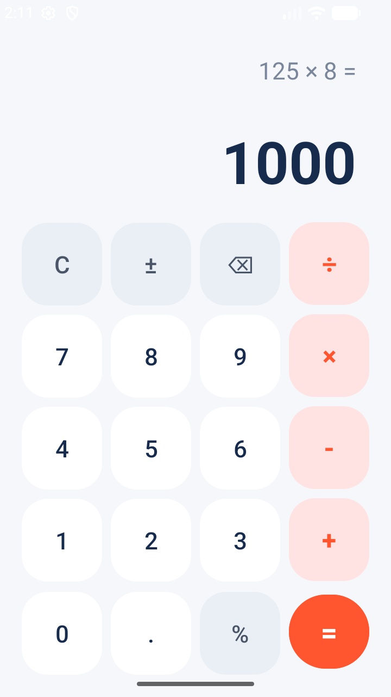

# Android Calculator App

A clean, modern, and robust Android calculator application built with Java and XML layout using the Model-View-Controller (MVC) architectural pattern.



---

## 📱 Features

- **Core Arithmetic**: Supports Addition (`+`), Subtraction (`-`), Multiplication (`×`), and Division (`÷`).
- **Special Operations**:
  - **Percentage (`%`)**: Easily calculate percentage operations.
  - **Sign Toggle (`±`)**: Toggle numbers between positive and negative values.
  - **Backspace (`⌫`)**: Remove single trailing digits during entry.
  - **Clear (`C`)**: Reset the calculator memory, expression, and result screen.
- **Operator Chaining**: Automatically evaluates current operations when chaining multiple operators sequentially (e.g., `125 × 8 =`).
- **Auto-Scaling Display**: Automatically scales input text size between `24sp` and `54sp` so long numerical entries never clip.
- **Defensive Error Handling**:
  - Gracefully handles division by zero (`5 ÷ 0`) by displaying `"Error"` instead of crashing.
  - Prevents `NumberFormatException` when interacting with error states.
  - Handles mathematical overflows and `NaN`/`Infinity` values safely.
- **Clean Number Formatting**: Automatically strips unnecessary trailing decimal zeros for whole integer results (e.g. `10.0` is rendered as `10`).

---

## 🏗️ Architecture & Project Structure

The project follows the **Model-View-Controller (MVC)** architectural pattern to maintain a clear separation between calculation business logic and UI presentation.

```
Calculator/
├── app/
│   ├── src/
│   │   ├── main/
│   │   │   ├── java/com/rd/calculator/
│   │   │   │   ├── CalculatorEngine.java    # Model: Core arithmetic & calculation logic
│   │   │   │   └── MainActivity.java        # Controller: UI event handlers & state manager
│   │   │   └── res/
│   │   │       ├── layout/
│   │   │       │   └── activity_main.xml    # View: Grid-based keypads & auto-scaling TextViews
│   │   │       └── values/
│   │   │           └── themes.xml           # App themes & launch performance styling
│   │   └── test/
│   │       └── java/com/rd/calculator/
│   │           └── ExampleUnitTest.java     # Unit tests for CalculatorEngine
│   └── build.gradle.kts                     # Module build configurations
├── docs/
│   └── screenshots/
│       └── main_activity.png                # App screenshot
└── README.md
```

### Components

- **Model ([CalculatorEngine.java](file:///Users/rajdip/myprac/AndroidStudioProjects/Calculator/app/src/main/java/com/rd/calculator/CalculatorEngine.java))**: Pure Java class responsible for processing calculation inputs and handling mathematical edge cases (such as division by zero returning `Double.NaN`).
- **Controller ([MainActivity.java](file:///Users/rajdip/myprac/AndroidStudioProjects/Calculator/app/src/main/java/com/rd/calculator/MainActivity.java))**: Manages button click events, updates active memory registers (`firstOperand`, `activeOperator`, `isNewInput`), formats numbers, and updates the display.
- **View ([activity_main.xml](file:///Users/rajdip/myprac/AndroidStudioProjects/Calculator/app/src/main/res/layout/activity_main.xml))**: Defines a 5-row by 4-column key matrix with custom styled buttons and auto-sizing text views for expression and result text.

---

## 🚀 Getting Started

### Prerequisites

- **Android Studio**: Jellyfish (2024.1.1) or higher / Android Studio Ladybug / Meerkat
- **JDK**: Java 17 or higher
- **Android SDK**: Compile SDK 34, Min SDK 24 (Android 7.0+)

### Building and Running

1. **Clone the repository**:
   ```bash
   git clone https://github.com/your-username/Calculator.git
   cd Calculator
   ```

2. **Build the project**:
   ```bash
   ./gradlew assembleDebug
   ```

3. **Run Unit Tests**:
   ```bash
   ./gradlew testDebugUnitTest
   ```

4. **Install on Device/Emulator**:
   ```bash
   ./gradlew installDebug
   ```

---

## 🧪 Unit Testing

Unit tests cover the core calculation engine in [ExampleUnitTest.java](file:///Users/rajdip/myprac/AndroidStudioProjects/Calculator/app/src/test/java/com/rd/calculator/ExampleUnitTest.java):
- Standard arithmetic operations verification.
- Division by zero safety checking.
- Percentage calculation accuracy.

To run the unit tests:
```bash
./gradlew :app:testDebugUnitTest
```

---

## 🛠️ Tech Stack

- **Language**: Java
- **UI Framework**: Android XML Layouts, AppCompat, Material Components
- **Build Tool**: Gradle with Kotlin DSL (`build.gradle.kts`)
- **Testing**: JUnit 4
